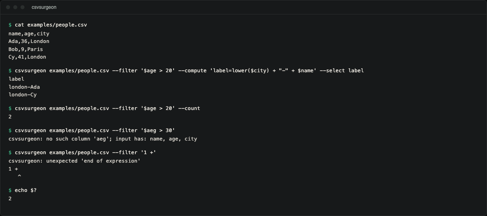

# csvsurgeon

A Python CLI that filters, computes and reshapes CSV files one row at a time
with a small expression language of its own, so the file is never loaded
into memory and filter strings never reach `eval`.

## Demo



Real terminal capture against `examples/people.csv`. The same session as text:

```
$ csvsurgeon examples/people.csv --filter '$age > 20' --compute 'label=lower($city) + "-" + $name' --select label
label
london-Ada
london-Cy
$ csvsurgeon examples/people.csv --filter '$age > 20' --count
2
$ csvsurgeon examples/people.csv --filter '$aeg > 30'
csvsurgeon: no such column 'aeg'; input has: name, age, city
$ csvsurgeon examples/people.csv --filter '1 +'
csvsurgeon: unexpected 'end of expression'
1 +
   ^
$ echo $?
2
```

Bob (age 9) is dropped because `"9"` and `20` are compared as numbers, not
as text.

**Quote expressions with single quotes.** Column references start with `$`,
so inside double quotes your shell expands `$age` to an empty string before
csvsurgeon sees it (`--filter "$age > 30"` arrives as ` > 30` and fails to
parse). Use single quotes around the expression and double quotes for string
literals inside it, or refer to columns by bare name (`age > 30`).

## Install

csvsurgeon is not published on PyPI. Install it from a clone (Python 3.10+,
no runtime dependencies):

```bash
git clone https://github.com/hellpuffyt/csvsurgeon
cd csvsurgeon
python3 -m venv .venv && . .venv/bin/activate
pip install .
```

`python -m csvsurgeon` works the same as the `csvsurgeon` script. A larger
pipeline (`sales.csv` stands in for your own file):

```bash
csvsurgeon sales.csv \
  --filter '$amount > 100 and $region ~ "north"' \
  --compute 'label=lower($region) + "-" + $customer' \
  --select "label,amount" \
  -o big-northern-sales.csv
```

## Why this exists

Two things go wrong with ad-hoc CSV surgery.

**Memory.** `pandas.read_csv` on a file larger than RAM does not get slower, it
dies. csvsurgeon is generators end to end: every operation reads one row and
yields one row, and `--head` closes the source rather than draining it.

Measured with the real console script on an Apple M5 (10 cores, 16 GB, macOS 27,
CPython 3.12), peak RSS from `/usr/bin/time -l`:

```bash
/usr/bin/time -l csvsurgeon sales.csv \
  --filter '$amount > 100 and $region ~ "north"' --count
```

| Input | Rows | Peak RSS | Wall time |
| --- | --- | --- | --- |
| 69 B | 3 | 21.9 MB | 0.06 s |
| 63 MB | 3,000,000 | 21.9 MB | 6.9 s |

The same working set (the interpreter itself) for a file 900,000 times larger.
`--head 3` on the 63 MB file returns in 0.07 s because it never reads the rest.
The guarantee is also
[asserted in the test suite](tests/test_pipeline.py) rather than only measured
once. If any step ever started buffering the stream, those tests fail.

**`eval`.** The obvious way to accept `--filter "$age > 30"` is to hand the
string to Python. That gives every filter flag on every data pipeline the full
power of the interpreter, on files that usually came from somewhere else.
csvsurgeon has a real tokenizer, parser and evaluator over a fixed set of
operations. `__import__('os')`, `().__class__` and `open('x')` are not
"blocked"; they have no meaning in the grammar and cannot be expressed
(`__import__` is reported as an unknown function).

## Operations

Operations run **in the order you write them**, which is what makes them
composable: a `--filter` after a `--compute` can test the computed column.

| Flag | Effect |
| --- | --- |
| `--filter EXPR` | keep rows where `EXPR` is true |
| `--compute NAME=EXPR` | add, or overwrite in place, column `NAME` |
| `--select COLS` | keep only these columns, in this order |
| `--drop COLS` | remove these columns |
| `--rename OLD=NEW,...` | rename, keeping column positions |
| `--fill NAME=VALUE` | replace empty values in `NAME` |
| `--head N` / `--skip N` | first N rows / all but the first N |

Plus `--count` (write how many rows survive, not the rows), `--header-only`
(show the resulting header without reading a single row), `-d/--delimiter`,
`--output-delimiter`, `--encoding` and `--version`. The input may be `-` for
stdin, and output goes to stdout unless `-o FILE` is given.

Exit status is `0` on success and `2` for any error: a bad expression, an
unknown column, malformed CSV, an encoding error or a bad flag. Errors are
one line on stderr, never a traceback.

## The expression language

**Columns**: `$name`, or a bare `name`. Use `$"total sales"` for names with
spaces.

**Literals**: `42`, `3.5`, `'text'`, `"text"`, `true`, `false`, `null`.

**Operators**: `or`, `and`, `not`, `== != < <= > >=`, `+ - * / %`, unary `-`,
and `~` for a case-insensitive "contains". Parentheses group. `and`/`or`
short-circuit, so `$x != '' and $x > 5` is safe on empty fields.

**Functions**: `upper` `lower` `trim` `len` `abs` `round` `num` `str`
`replace` `contains` `startswith` `endswith` `substr` `coalesce` `concat`
`split`.

### Text that is secretly a number

Every CSV field is text. Comparing `"9"` against `30` as strings says 9 is
larger, which would silently corrupt every numeric filter ever written. So when
both sides of a comparison look like numbers, they are compared as numbers:

```bash
csvsurgeon examples/people.csv --filter '$age > 30'   # Bob, 9, is not kept
```

`+` follows the same idea from the other side: it adds when both sides are
numbers and concatenates otherwise, which is how you build labels.

## Errors point at the problem

Parse errors print the expression with a caret under the problem (see the
`'1 +'` example in the demo). Column names are checked against the header
**before the first row is read**, so a typo such as `$aeg` fails in
milliseconds on a file of any size rather than an hour in.

## Real files

The dialect (`,` `;` tab `|`) is sniffed from a sample and the sample is pushed
back, so the header is never eaten by the sniff. Quoted fields containing
commas and newlines survive a round trip. Short rows are padded with empty
values. Long rows do not crash the run, but the CLI writes only the header's
columns, so fields beyond the header's width are dropped from the output.
`io.read_rows` keeps them under an `_overflow` key for library users; they
are not addressable from expressions.

### Limits and refusals

These exist so a bad input fails loudly instead of producing a wrong file:

* A single field larger than Python's `csv` limit (128 KiB) is reported as
  malformed input, which also bounds memory per row.
* A header that repeats a column name is refused. Rows are keyed by name, so
  one column would silently overwrite the other.
* `-o` pointing at the input file is refused: the output would be truncated
  while the input is still being read.
* Only plain decimal text (`42`, `-3.5`, `.5`, `1e3`) is treated as a number.
  Words such as `nan`, `inf` and `Infinity` stay text, so `$name == 'Nan'`
  matches a person called Nan.
* Expressions may nest at most 100 levels deep.
* Input that is not valid in `--encoding` (default UTF-8) stops with exit code
  2 and a message, not a traceback.

## As a library

```python
from csvsurgeon.expr import parse
from csvsurgeon.io import read_rows, write_rows
from csvsurgeon.pipeline import Compute, Filter, Pipeline

pipeline = Pipeline([
    Filter(parse("$age > 30"), "$age > 30"),
    Compute("loud", parse("upper($name)"), "upper($name)"),
])

with open("people.csv", newline="") as handle:
    header, rows = read_rows(handle)
    with open("out.csv", "w", newline="") as out:
        write_rows(out, pipeline.header(header), pipeline.apply(rows))
```

## Development

```bash
pip install -e ".[dev]"   # inside the virtualenv from Install
pytest -q                 # 206 tests
ruff check .              # lint
mypy                      # strict types
```

CI runs the tests on Linux, macOS and Windows with Python 3.10 to 3.13, plus
ruff, strict mypy, coverage, and the demo pipeline above as a smoke test.
See [CONTRIBUTING.md](CONTRIBUTING.md) for the design rules a change has to
keep (no buffering, no `eval`, no runtime dependencies).

## Security

See [SECURITY.md](SECURITY.md). The audit evidence for this version is in
[docs/PRODUCTION_READINESS.md](docs/PRODUCTION_READINESS.md).

## License

MIT. See [LICENSE](LICENSE).
